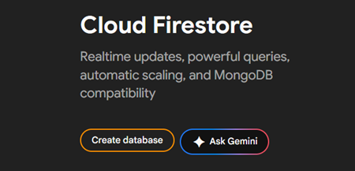
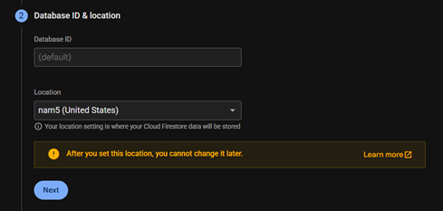

# Pertemuan 7 — Firebase – Cloud Firestore

## I. Tujuan

1. Mahasiswa mampu memahami perbedaan konsep SQL (_Relational_) dan NoSQL (_Document-based_).
2. Mahasiswa mampu melakukan konfigurasi Firebase Firestore pada _project_ Flutter.
3. Mahasiswa memahami konsep _Reactive Programming_ menggunakan _Stream_.

---

## II. Teori

### 2.1 Konsep Persistensi Data: Lokal vs Cloud

Dalam pengembangan aplikasi mobile, keputusan mengenai di mana data disimpan sangat menentukan perilaku aplikasi, terutama saat pengguna berpindah perangkat. Terdapat dua pendekatan arsitektur utama:

#### A. Penyimpanan Lokal (_Local Storage_)

Pada modul-modul sebelumnya (menggunakan _SharedPreferences_), kita menerapkan penyimpanan lokal.

- **Definisi**: Data disimpan secara fisik di dalam memori internal perangkat pengguna (_device-only_).
- **Karakteristik**: Data bersifat terisolasi. Aplikasi bertindak sebagai "pemilik" tunggal data tersebut di perangkat itu saja.
- **Implikasi**: Jika pengguna login menggunakan perangkat berbeda, atau jika aplikasi di-_uninstall_, data tersebut tidak dapat diakses kembali atau hilang permanen. Metode ini cocok untuk menyimpan konfigurasi ringan seperti tema aplikasi atau _onboarding_ status.

#### B. Penyimpanan Berbasis _Cloud_ (_Cloud Storage - Firestore_)

Untuk fitur seperti "Anime Favorit" yang datanya harus bernilai tetap (_persistent_) meskipun pengguna berganti HP, kita memerlukan penyimpanan berbasis _Cloud_ (Server).

- **Definisi**: Data disimpan di infrastruktur server terpusat (dalam hal ini Google Cloud). Perangkat pengguna hanya berfungsi sebagai "klien" untuk menampilkan data.
- **Karakteristik Utama**:
  - **Sentralisasi Data (_Single Source of Truth_)**: Data tidak lagi menempel pada perangkat. Server memegang kendali penuh atas kebenaran data.
  - **Sinkronisasi Langsung (_Live Synchronization_)**: Berbeda dengan database konvensional yang mengharuskan kita me-_refresh_ halaman (_pull_), Cloud Firestore menggunakan koneksi aktif (_listeners_). Server secara otomatis mendorong (_push_) data baru ke perangkat segera setelah ada perubahan, memastikan tampilan UI selalu mutakhir tanpa intervensi pengguna.
  - **Dukungan Offline (_Offline Persistence_)**: SDK Firebase secara cerdas menyimpan salinan sementara (_cache_) di perangkat. Aplikasi tetap dapat membaca dan menulis data saat tidak ada koneksi internet, dan akan menyinkronkannya ke Cloud secara otomatis begitu koneksi pulih.

### 2.2 Database: Realtime Database vs Cloud Firestore

Dalam ekosistem Firebase, terdapat dua pilihan layanan basis data (_database_) berbasis _Cloud_ yang seringkali membingungkan pengembang pemula: **Firebase Realtime Database** dan **Cloud Firestore**. Keduanya adalah database NoSQL, namun memiliki perbedaan arsitektur yang fundamental.

#### A. Realtime Database

Ini adalah produk basis data orisinal dari Firebase.

- **Model Data**: Menyimpan seluruh data sebagai satu pohon JSON besar (_One Giant JSON Tree_). Tidak ada konsep tabel atau koleksi; semua data adalah _node_ dalam struktur JSON.
- **Karakteristik**: Memiliki latensi yang sangat rendah, sehingga ideal untuk sinkronisasi data sederhana yang membutuhkan kecepatan tinggi, seperti indikator status _online_/_offline_ pengguna.
- **Keterbatasan**: Kemampuan penyaringan (_querying_) terbatas. Anda hanya dapat mengurutkan atau memfilter berdasarkan satu properti pada satu waktu. Selain itu, mengambil data di _root node_ akan mengunduh seluruh cabang di bawahnya, yang tidak efisien untuk data kompleks.

#### B. Cloud Firestore

Cloud Firestore adalah generasi penerus yang dirancang untuk menutupi kekurangan Realtime Database.

- **Model Data**: Menggunakan struktur Dokumen dan Koleksi (_Document-Collection Model_). Ini lebih mirip dengan struktur folder dalam sistem operasi, yang memungkinkan organisasi data yang lebih hierarkis dan terstruktur.
- **Karakteristik**:
  - **Query Ekspresif**: Mendukung kueri majemuk (_compound queries_), seperti memfilter berdasarkan kategori dan mengurutkan berdasarkan tanggal sekaligus.
  - **Skalabilitas Otomatis**: Dirancang untuk menangani aplikasi berskala global tanpa perlu melakukan _sharding_ (pemecahan database) secara manual.
- **Rekomendasi**: Google merekomendasikan Cloud Firestore untuk aplikasi dengan model data yang kaya (_rich data models_), seperti manajemen profil pengguna, inventaris barang, atau dalam kasus kita: daftar Anime Favorit.

Pada modul praktikum ini, kita memutuskan untuk menggunakan Cloud Firestore. Keputusan ini didasari oleh kebutuhan fitur "Favorite Anime" yang memerlukan struktur data terisolasi per pengguna (**users/{uid}/favorites**) dan kemampuan untuk melakukan _query_ yang efisien tanpa membebani _bandwidth_ pengguna.

### 2.3 Model Data Cloud Firestore: Collection, Document, dan Data

Dalam basis data SQL konvensional, kita terbiasa dengan struktur tabel dua dimensi (baris dan kolom). Namun, Cloud Firestore adalah basis data NoSQL berorientasi dokumen. Untuk memahaminya, mari kita bayangkan sebuah Sistem Pengarsipan Kantor fisik, sebagaimana diilustrasikan dalam konsep model data Firestore.


#### A. Analogi Pengarsipan

1. **_Collections_ (Koleksi)** = Folder Besar
   - Wadah untuk menyimpan banyak dokumen.
   - Koleksi hanya boleh berisi Dokumen. Ia tidak bisa menyimpan data (seperti String atau Angka) secara langsung.
   - Contoh: Koleksi users, koleksi animes.
2. **_Documents_ (Dokumen)** = Lembaran Kertas / File
   - Unit data individual yang berisi informasi aktual.
   - Data disimpan dalam pasangan _Key-Value_ (Kunci-Nilai).
   - Aturan Penting: Dokumen harus berada di dalam Koleksi. Dokumen tidak bisa "mengambang" sendirian.

#### B. Struktur Data Hierarkis (_Sub-collections_)

Salah satu fitur terkuat Firestore adalah kemampuan untuk membuat koleksi di dalam sebuah dokumen. Ini disebut Sub-collection.

Dalam project ini, kita tidak akan mencampur aduk data favorit semua user dalam satu wadah besar. Kita akan memberikan "Laci Pribadi" untuk setiap user. Perhatikan struktur data untuk fitur Favorites yang akan kita implementasikan:

```text
(Collection) "users"
  │
  └── (Document) "uid_user_misal_123"
        │
        └── (Sub-collection) "favorites"  <-- INI ADALAH SUB-COLLECTION
              │
              ├── (Document) "52991" (Ini adalah ID Anime dari API/MAL)
              │     │
              │     ├── title: "Sousou no Frieren"
              │     ├── score: 9.29
              │     ├── status: "Finished Airing"
              │     └── ... (data lengkap anime)
```

Analisa Struktur:

- **_Root Collection_**: users.
- **_Parent Document_**: Dokumen dengan ID pengguna (uid). Dokumen ini bisa saja kosong field-nya, dan hanya berfungsi sebagai "induk" untuk sub-koleksi.
- **_Sub-collection_**: favorites. Koleksi ini hidup secara eksklusif di bawah user tertentu. User A tidak bisa mengintip isi favorites milik User B karena jalurnya berbeda.

---

## III. Persiapan _Environment_

Sebelum masuk ke penulisan kode logika, kita perlu mempersiapkan infrastruktur backend di Firebase Console dan mendaftarkan _package_ yang dibutuhkan pada aplikasi Flutter.

### 3.1 Aktifkan Cloud Firestore di Firebase Console

Karena secara default layanan Firestore belum aktif, kita perlu menginisialisasinya terlebih dahulu agar aplikasi memiliki tempat untuk menyimpan data.

1. Buka Firebase Console dan pilih project yang telah Anda buat di modul sebelumnya.
2. Pada panel navigasi sebelah kiri, di bagian Build, pilih Firestore Database.


3. Klik tombol Create Database.



4. Langkah 1: Database Settings (Edition)

>)

- Biarkan default (Standard edition).
- Klik Next.

5. Langkah 2: Database Setting



- Biarkan default (nam5)
- Klik Next.

6. Langkah 4: Security Rules (Penting)


- Pilih **Start in Test mode**.
- Penjelasan: Mode ini mengizinkan siapa saja (selama mengetahui ID project) untuk membaca dan menulis data selama 30 hari ke depan. Ini memudahkan proses debugging saat praktikum tanpa terhalang masalah perizinan.
- Klik Enable.

**Peringatan Keamanan**: Dalam aplikasi rilis (production), Test Mode sangat berbahaya. Namun, untuk keperluan pembelajaran di kelas ini, kita menggunakannya agar fokus pada logika aplikasi terlebih dahulu, bukan pada kompleksitas aturan keamanan.

Lalu, pastikan **Rules** seperti berikut

```
match /{document=**} {
  allow read, write: if true;
}
```

### 3.2 Instalasi Dependensi

Kita membutuhkan paket cloud_firestore untuk menghubungkan kode Dart dengan SDK Firestore native (Android/iOS).

1. Buka terminal di dalam IDE (pastikan berada di root folder project).
2. Jalankan perintah berikut:

**Terminal**

```bash
flutter pub add cloud_firestore
```

3. Cek package di file pubspec.yaml, pastikan sudah terdaftar:

**`pubspec.yaml`**

```yaml
cloud_firestore: ^6.1.0
```

## IV. Praktik

### 4.1. Todo Model

Langkah pertama adalah membuat Todo Model untuk mendefinisikan struktur data tugas di dalam aplikasi.

Model ini bertanggung jawab sebagai blueprint yang menerjemahkan data berformat JSON dari Firestore menjadi objek Dart, serta membungkus kembali objek tersebut menjadi Map agar bisa disimpan ke database. Memisahkan model data memastikan antarmuka tidak berurusan langsung dengan data mentah.
`models/todo.dart`

```dart
import 'package:cloud_firestore/cloud_firestore.dart';

class Todo {
  final String id;
  final String task;
  final bool isDone;
  final Timestamp? createdAt;

  Todo({
    required this.id,
    required this.task,
    required this.isDone,
    this.createdAt,
  });

  // Mengubah data dari Firestore menjadi Objek Dart
  factory Todo.fromFirestore(DocumentSnapshot doc) {
    Map<String, dynamic> data = doc.data() as Map<String, dynamic>;
    return Todo(
      id: doc.id,
      task: data['task'] as String,
      isDone: data['isDone'] as bool,
      createdAt: data['createdAt'] as Timestamp?,
    );
  }

  // Mengubah Objek Dart menjadi format yang diterima Firestore
  Map<String, dynamic> toMap() {
    return {
      'task': task,
      'isDone': isDone,
      'createdAt': createdAt ?? FieldValue.serverTimestamp(),
    };
  }
}
```

### 4.2. Firestore Service

Setelah model data siap, langkah selanjutnya adalah membuat Firestore Service pada file services/firestore_service.dart untuk menangani komunikasi langsung dengan basis data Cloud Firestore.

Service ini bertanggung jawab memusatkan seluruh logika operasi CRUD, seperti menambah (`addTodo`), membaca (`getTodos`), memperbarui status (`updateTodoStatus`), dan menghapus dokumen (`deleteTodo`). Dengan memisahkan logika database dari antarmuka pengguna, kode aplikasi menjadi lebih modular dan mudah dipelihara.

`services/firestore_service.dart`

```dart
import 'package:cloud_firestore/cloud_firestore.dart';
import '../models/todo.dart';

class FirestoreService {
  final CollectionReference _todosCollection =
  FirebaseFirestore.instance.collection('todos');

  // 1. CREATE
  Future<void> addTodo(String taskName) async {
    final newTodo = Todo(id: '', task: taskName, isDone: false);
    await _todosCollection.add(newTodo.toMap());
  }

  // 2. READ (Mengembalikan Stream berisi List of Objek Todo)
  Stream<List<Todo>> getTodos() {
    return _todosCollection
        .orderBy('createdAt', descending: true)
        .snapshots()
        .map((snapshot) =>
        snapshot.docs.map((doc) => Todo.fromFirestore(doc)).toList());
  }

  // 3. UPDATE
  Future<void> updateTodoStatus(String id, bool currentStatus) async {
    await _todosCollection.doc(id).update({'isDone': !currentStatus});
  }

  // 4. DELETE
  Future<void> deleteTodo(String id) async {
    await _todosCollection.doc(id).delete();
  }
}
```

### 4.3. CREATE

#### 4.3.1. Todo Dialog

Komponen ini berfungsi sebagai formulir pop-up (AlertDialog) yang menerima masukan nama tugas dari pengguna, lalu meneruskan teks tersebut ke fungsi addTodo pada FirestoreService saat tombol Save ditekan
`widgets/todo_dialog.dart`

```dart
import 'package:flutter/material.dart';
import '../services/firestore_service.dart';

class TodoDialog extends StatefulWidget {
  final FirestoreService firestoreService;

  const TodoDialog({super.key, required this.firestoreService});

  @override
  State<TodoDialog> createState() => _TodoDialogState();
}

class _TodoDialogState extends State<TodoDialog> {
  final TextEditingController _taskController = TextEditingController();

  @override
  void dispose() {
    _taskController.dispose();
    super.dispose();
  }

  @override
  Widget build(BuildContext context) {
    return AlertDialog(
      title: const Text('Add Todo'),
      content: TextField(
        controller: _taskController,
        autofocus: true,
        decoration: const InputDecoration(hintText: 'Add new task...'),
      ),
      actions: [
        TextButton(
          onPressed: () => Navigator.pop(context),
          child: const Text('Cancel'),
        ),
        ElevatedButton(
          onPressed: () {
            if (_taskController.text.trim().isNotEmpty) {
              widget.firestoreService.addTodo(_taskController.text.trim());
              Navigator.pop(context);
            }
          },
          child: const Text('Save'),
        ),
      ],
    );
  }
}
```

#### 4.3.2. Todo Screen

Setelah dialog siap, layar utama TodoScreen dibuat pada file screens/todo_screen.dart dengan menambahkan FloatingActionButton yang bertugas memanggil dan memunculkan TodoDialog. Selain itu, alur navigasi pada file screens/auth_gate.dart juga diperbarui agar mengarahkan pengguna yang telah terautentikasi langsung ke layar.
`screens/todo_screen.dart`

```dart
import 'package:flutter/material.dart';
import '../services/firestore_service.dart';
import '../widgets/todo_dialog.dart';

class TodoScreen extends StatelessWidget {
  final FirestoreService _firestoreService = FirestoreService();

  TodoScreen({super.key});

  @override
  Widget build(BuildContext context) {
    return Scaffold(
      appBar: AppBar(title: const Text('Todo List')),
      floatingActionButton: FloatingActionButton(
        onPressed: () {
          showDialog(
            context: context,
            builder: (context) => TodoDialog(firestoreService: _firestoreService),
          );
        },
        child: const Icon(Icons.add),
      ),
    );
  }
}
```

lalu pada Auth Gate, ganti `ProfileScreen` menjadi `TodoScreen`
`screens/auth_gate.dart`

```dart
return StreamBuilder(
    stream: _auth.authStateChanges,
    builder: (context, snapshot){
      if(snapshot.hasData){
        return TodoScreen();
      }else {
        return SignInScreen();
      }
    }
);
```

### 4.4. READ

#### 4.4.1. Todo Item

Langkah pertama dalam menyajikan data adalah merancang komponen TodoItem menggunakan widget CheckboxListTile. Komponen ini bertanggung jawab menampilkan satu baris data tugas, termasuk teks tugas (dengan efek coret jika sudah selesai) serta status centangnya.

`widgets/todo_item.dart`

```dart
import 'package:flutter/material.dart';
import '../models/todo.dart';
import '../services/firestore_service.dart';

class TodoItem extends StatelessWidget {
  final Todo todo;
  final FirestoreService firestoreService;

  const TodoItem({
    super.key,
    required this.todo,
    required this.firestoreService,
  });

  @override
  Widget build(BuildContext context) {
    return CheckboxListTile(
      title: Text(
        todo.task,
        style: TextStyle(
          decoration: todo.isDone ? TextDecoration.lineThrough : null,
        ),
      ),
      value: todo.isDone,
      onChanged: (_) => (),
    );
  }
}
```

#### 4.4.2. Todo Screen

Selanjutnya, layar screens/todo_screen.dart diperbarui pada bagian body dengan menambahkan widget StreamBuilder yang memantau aliran data dari fungsi getTodos() secara real-time. Komponen ini bertugas menyusun dan me-render kumpulan data tugas tersebut ke dalam daftar gulir (ListView.builder) menggunakan komponen TodoItem.

Tambahkan properties body
`screens/todo_screen.dart`

```dart
body: StreamBuilder<List<Todo>>(
  stream: _firestoreService.getTodos(),
  builder: (context, snapshot) {
    if (snapshot.connectionState == ConnectionState.waiting) {
      return const Center(child: CircularProgressIndicator());
    }
    if (!snapshot.hasData || snapshot.data!.isEmpty) {
      return const Center(child: Text('Belum ada tugas.'));
    }
    final todos = snapshot.data!;
    return ListView.builder(
      itemCount: todos.length,
      itemBuilder: (context, index) {
        return TodoItem(
          todo: todos[index],
          firestoreService: _firestoreService,
        );
      },
    );
  },
),
```

### 4.5. UPDATE

#### 4.5.1. Todo Item

Untuk mengaktifkan fitur pembaruan status, modifikasi dilakukan pada properti onChanged di dalam file widgets/todo_item.dart. Saat pengguna menekan checkbox, antarmuka secara otomatis memicu fungsi updateTodoStatus pada FirestoreService untuk mengubah status penyelesaian tugas (nilai Boolean) pada dokumen Firestore terkait

Edit propertis Onchanged
`widgets/todo_item.dart`

```dart
onChanged: (_) => firestoreService.updateTodoStatus(todo.id, todo.isDone),
```

### 4.6. DELETE

#### 4.6.1. Todo Item

Langkah terakhir adalah mengimplementasikan fitur penghapusan data dengan membungkus widget CheckboxListTile menggunakan widget Dismissible di dalam file widgets/todo_item.dart. Fitur ini menyediakan interaksi swipe-to-delete yang menampilkan latar belakang berwarna merah dan ikon tempat sampah, serta memicu fungsi deleteTodo untuk menghapus dokumen secara permanen dari Firestore saat item digeser.

Bungkus Widget `CheckBoxListTile` dengan widget `Dismissible`

`widgets/todo_itemm.dart`

```dart
import 'package:flutter/material.dart';
import '../models/todo.dart';
import '../services/firestore_service.dart';

class TodoItem extends StatelessWidget {
  final Todo todo;
  final FirestoreService firestoreService;

  const TodoItem({
    super.key,
    required this.todo,
    required this.firestoreService,
  });

  @override
  Widget build(BuildContext context) {
    return Dismissible(
      key: Key(todo.id),
      direction: DismissDirection.endToStart,
      background: Container(
        color: Colors.red,
        alignment: Alignment.centerRight,
        padding: const EdgeInsets.only(right: 20),
        child: const Icon(Icons.delete, color: Colors.white),
      ),
      onDismissed: (_) => firestoreService.deleteTodo(todo.id),
      child: CheckboxListTile(
        title: Text(
          todo.task,
          style: TextStyle(
            decoration: todo.isDone ? TextDecoration.lineThrough : null,
          ),
        ),
        value: todo.isDone,
        onChanged: (_) => firestoreService.updateTodoStatus(todo.id, todo.isDone),
      ),
    );
  }
}
```
